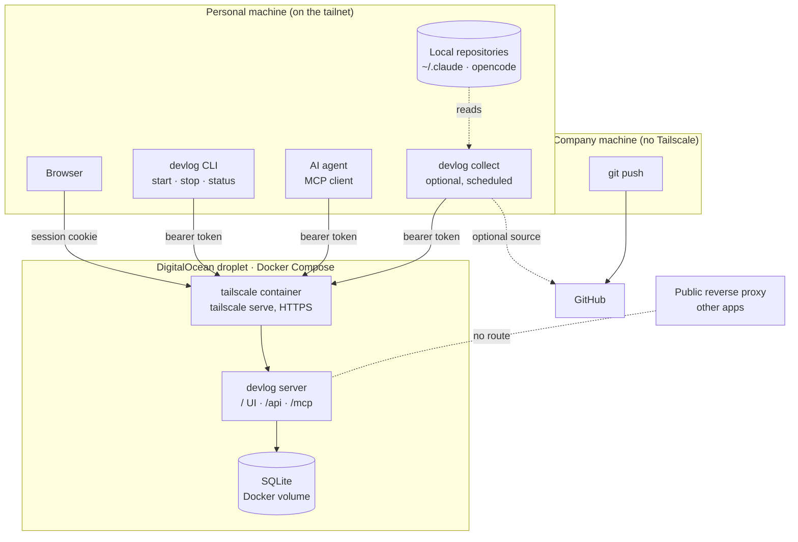

# Architecture

DevLog is a personal time tracker for one user. A server on a private host
keeps the data; a browser UI, a command-line client, and AI agents read and
write it over HTTP. Activity collection is optional and runs on the user's own
machines.

This describes the target architecture (v1). Only the CLI exists today; see
the [roadmap](roadmap.md).

## Components

| App | Language | Runs on | Role |
| --- | --- | --- | --- |
| [`apps/server`](../apps/server/) | Go | The droplet, in Docker | Stores the data in SQLite; serves the JSON API at `/api`, the MCP endpoint at `/mcp`, and the web UI at `/` |
| [`apps/web`](../apps/web/) | TypeScript, React | The browser | Logs time, runs the timer, manages projects, shows reports and suggestions |
| [`apps/cli`](../apps/cli/) | Go | The user's machines | Collects activity and sends it to the server; starts and stops the timer |

The server is the only component that touches the database. Everything else
is an HTTP client of it. See [ADR 005](decisions/005-separate-cli-and-server.md).

## How they communicate



| From | To | Over | Authentication |
| --- | --- | --- | --- |
| Browser | `/` and `/api` | HTTPS on the tailnet | Session cookie |
| CLI | `/api` | HTTPS on the tailnet | Bearer token |
| `devlog collect` | `POST /api/activity` | HTTPS on the tailnet | Bearer token |
| AI agent | `/mcp` | HTTPS on the tailnet | Bearer token |
| `devlog collect` | GitHub API | HTTPS on the internet | GitHub token, optional |

## Network boundary

The server has no published port. It shares the network of a Tailscale
container, which serves it over HTTPS on the tailnet only. The droplet's
public reverse proxy, which serves other applications, has no route to it.
See [ADR 002](decisions/002-private-access-over-tailscale.md) and
[ADR 006](decisions/006-docker-compose-deployment.md).

The company machine cannot join the tailnet, so it is not a client. Work
pushed from it reaches DevLog only if the GitHub source can read those
repositories, which company organizations often prevent. Time spent on it is
logged from the UI on another device.

## Data

SQLite holds projects, time entries, collected activity, collector runs, and
browser sessions. Time entries are what the user curates; activity is raw
evidence that suggestions are built from, and a collection never changes a
time entry. See [ADR 003](decisions/003-sqlite-storage.md) and the
[data model](data-model.md).

## Collection

`devlog collect` runs on a schedule on each machine where the user wants it.
It reads Git repositories, Claude Code transcripts, opencode sessions, and,
when a token allows, GitHub, and posts the result to the server. The server
merges activity by its source, so collecting the same commit from two places
stores it once. The server never collects by itself. See
[ADR 007](decisions/007-collection-on-devices.md).

## Repository layout

```
apps/
  cli/      Go module: the devlog command and the collectors
  server/   Go module: API, MCP, SQLite, serves the built web UI
  web/      Vite + React app
docs/
  decisions/  architecture decision records
  cli/        CLI reference
```

See [ADR 004](decisions/004-monorepo-with-apps.md).
