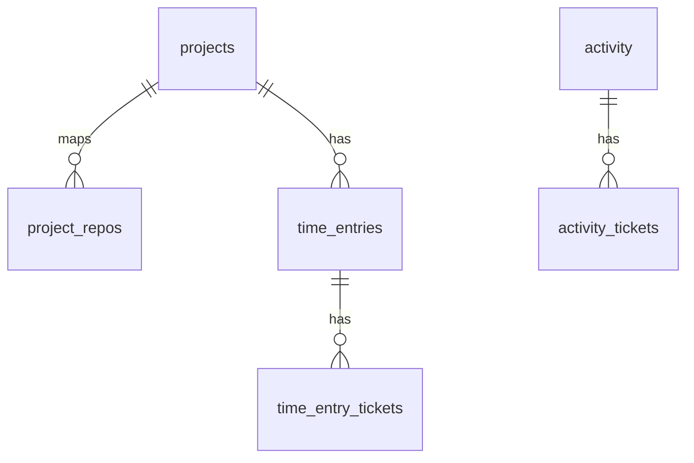

# Data model

Draft. The server's SQLite schema, to be refined while phase 1 is built. Times
are stored in UTC; a day is a calendar day in the server's configured time
zone.

## projects

| Column | Type | Notes |
| --- | --- | --- |
| `id` | text | UUID |
| `name` | text | Unique |
| `client` | text | Free text, optional |
| `color` | text | Hex color |
| `estimate_minutes` | integer | Optional |
| `archived_at` | text | Null while active |
| `created_at`, `updated_at` | text | RFC 3339 |

## project_repos

Maps a collected repository (`owner/repo`, or a directory name without a
remote) to a project, so activity and suggestions get the right project.

| Column | Type |
| --- | --- |
| `project_id` | text |
| `repo` | text, unique |

## time_entries

| Column | Type | Notes |
| --- | --- | --- |
| `id` | text | UUID |
| `project_id` | text | Optional |
| `description` | text | |
| `day` | text | `YYYY-MM-DD` |
| `start_at` | text | Optional |
| `end_at` | text | Optional |
| `minutes` | integer | Optional |
| `created_at`, `updated_at` | text | |

An entry takes one of three shapes:

| Shape | `start_at` | `end_at` | `minutes` |
| --- | --- | --- | --- |
| Interval | set | set | derived from the interval |
| Duration only | null | null | set |
| Running timer | set | null | null |

A partial unique index on the running shape allows one timer at a time.

## time_entry_tickets

Ticket keys such as `PROJ-236`. They play the role of tasks; there is no task
table.

| Column | Type |
| --- | --- |
| `entry_id` | text |
| `ticket` | text |

## activity

Collected evidence, one row per source (such as `commit:<sha>` or
`claude-code:session:<id>:<day>`). It carries the fields the CLI collects
today: kind, collector, occurred and ended times, repository, branch, device,
URL, SHA, number, action, directory, change counts, item count, and, from
phase 5, the active intervals of a session as JSON. `activity_tickets` holds
its ticket keys.

A later collection of the same source merges into the stored row: snapshot
kinds (sessions, branch activity, comments) replace it, other kinds only fill
missing fields.

## collector_runs

Per device and collector: the last run, the last success, the window it
covered, the number of entries, and the skip reason or error.

## sessions

Browser sessions: a hash of the session ID and its expiry.

Deletes are hard deletes; nothing is synchronized, so no tombstones are
needed.
